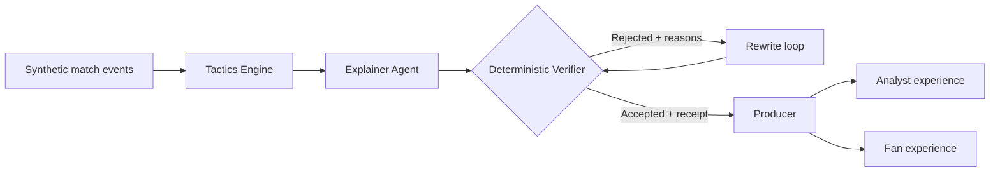

# FIEL — Football Intelligence Engine, Live

> **Every sentence on air comes with a receipt.**

[](https://www.python.org/)
[](https://ai.azure.com/)
[](LICENSE)
[](#project-status)

FIEL turns a live stream of **synthetic football events** into clear, timely and verifiable match insights for broadcasters and fans. Instead of asking an AI model to improvise commentary, FIEL gives it computed facts, requires it to cite the underlying event IDs, and checks every claim before it can go on air.

Built for the **Microsoft × Premier League Inside the Game Hackathon**, FIEL addresses the challenge **“The Synthetic Match Insights Engine for Premier League Studio.”**

## The problem

Live football produces more data than a production team or viewer can interpret in real time. AI can turn that data into natural language, but three problems remain:

- **Signal overload:** raw passes, shots and recoveries do not explain what is changing in the match.
- **Trust:** a fluent AI-generated sentence can still contain a wrong number, cite the wrong time window or overstate correlation as causation.
- **One-size-fits-all output:** a studio analyst and a casual fan need different levels of detail, even when the underlying facts are the same.

In a live broadcast, a confident but unsupported statement is worse than no statement at all.

## Our solution

FIEL separates **facts** from **storytelling**.

1. A generator creates realistic matches between fictional teams, including known tactical patterns that can be used as ground truth.
2. A deterministic tactics engine calculates possession, pressing, shot quality and win probability directly from match events.
3. An Explainer powered by Microsoft Foundry selects a meaningful fact and writes a short broadcast claim.
4. A non-AI Verifier independently recomputes the metric and checks the cited evidence, time window and causal language.
5. If the claim fails, it is returned with a precise reason and rewritten. If it still fails, it never goes on air.
6. Accepted intelligence can then be produced and personalized for different audiences without changing the facts.

The result is a simple promise: **every published claim can show exactly where it came from.**

## How it works



Each candidate insight is a structured object rather than unrestricted prose:

```json
{
  "claim": "Team B recovered the ball higher up the pitch between minutes 69 and 79.",
  "metric": "recovery_height",
  "value": 59.5,
  "team": "B",
  "window_start": 69,
  "window_end": 79,
  "event_ids": ["e0812", "e0839", "e0871", "e0904", "e0930"],
  "causal": false,
  "confidence": 0.91
}
```

The receipt is the metric, value, time window and supporting event IDs. The Verifier uses those fields to reproduce the calculation without relying on the language model.

## Five-stage insight pipeline

| Stage | What FIEL does | Current component |
| --- | --- | --- |
| **Ingest** | Creates and validates event-by-event synthetic match data | Synthetic Generator + Pydantic schemas |
| **Interpret** | Converts events into tactical signals | Tactics Engine |
| **Explain** | Finds a relevant story and attaches supporting evidence | Foundry Explainer + Verifier |
| **Render** | Selects and formats accepted insights for delivery | Producer *(in development)* |
| **Personalize** | Changes language and depth while preserving the verified facts | Personalizer *(in development)* |

## What makes FIEL different

- **Evidence by design:** claims must cite real event IDs from the selected match window.
- **Independent verification:** facts are recalculated in Python; the AI does not grade its own work.
- **Visible failure recovery:** rejected claims receive specific feedback and enter a bounded rewrite loop.
- **Measurable synthetic ground truth:** the generator deliberately plants tactical stories, allowing us to measure whether the system discovers them.
- **Causality guardrails:** phrases such as “won the game” are blocked unless the claim is explicitly causal and has enough evidence.
- **Safe personalization:** future audience modes may change wording, language and detail, but not the verified numbers or evidence.
- **No third-party match data:** all teams, players and events are fictional and generated specifically for this project.

## Current capabilities

- Four fictional tactical team profiles: high press, low-block counter, possession and direct play
- Six reproducible synthetic matches with 800–1,200 events each
- Ten planted tactical stories with separate ground-truth files
- Verified metrics: possession, recovery height, shots, shots on target, goals and pass accuracy
- Tactical analytics: five-minute pressure index, transparent xG and Monte Carlo/Poisson win probability
- Microsoft Foundry integration through the OpenAI-compatible v1 endpoint
- Narrate → verify → rewrite loop with a maximum of two rewrites
- A staged demo in which an unsupported causal claim is rejected and corrected
- 16 offline tests across generation, verification and tactical analytics

## Demo: rejection before broadcast

The terminal demo intentionally proposes an exaggerated statement:

```text
"The substitution at 69' won the game for team B."
```

The Verifier rejects it because the causal language is not supported by enough evidence. The Explainer receives that reason and rewrites the statement as a measurable observation. Only the verified version is marked **ON AIR**.

This is the central FIEL interaction: the audience sees the useful insight, while the production team can inspect its receipt and the system's reasoning trail.

## Quick start

### Requirements

- Python 3.12 or later
- A Microsoft Foundry project with a deployed model
- Foundry endpoint and API key for the optional model-powered demo

### Install

```bash
git clone https://github.com/Lmg15186/fiel.git
cd fiel

python3.12 -m venv .venv
source .venv/bin/activate  # Windows: .venv\Scripts\activate
pip install -r requirements.txt
```

### Run the offline tests

The tests do not call a model and do not require Azure credentials.

```bash
pytest -q
```

Expected result: `16 passed`.

### Generate synthetic matches

```bash
python -m fiel.generator --matches 6 --seed 2026 --out data
```

For every match, FIEL writes an event file and a separate `_truth.json` file containing the stories intentionally planted for evaluation.

### Configure Microsoft Foundry

```bash
cp .env.example .env
```

Add your own values to `.env`:

```dotenv
FOUNDRY_ENDPOINT=https://your-resource.openai.azure.com/openai/v1
FOUNDRY_API_KEY=your-key
FOUNDRY_DEPLOYMENT=gpt-5-mini
```

Never commit `.env` or expose an API key in logs, screenshots or issues.

### Run the end-to-end demo

```bash
python run_demo.py data/m-003-T4-T3.json
```

The demo prints tactical context, candidate claims, acceptance or rejection reasons, and the final statement allowed on air. It also writes the attempt history to `data/last_run.json`.

For a more detailed setup guide, see [docs/SETUP.md](docs/SETUP.md). The event contract is documented in [docs/EVENT_SCHEMA.md](docs/EVENT_SCHEMA.md).

## Repository structure

```text
fiel/
├── data/                  # Synthetic matches and planted-story ground truth
├── docs/                  # Setup guide and event contract
├── fiel/
│   ├── claims.py          # Typed Event, Match, Claim and Verdict contracts
│   ├── explainer.py       # Foundry Explainer and bounded rewrite loop
│   ├── generator.py       # Synthetic match and story generator
│   ├── llm_json.py        # JSON-only Foundry model client
│   ├── tactics.py         # Pressure, xG and win-probability calculations
│   └── verifier.py        # Deterministic evidence and causality checks
├── tests/                 # Offline unit tests
└── run_demo.py            # End-to-end terminal demonstration
```

## Microsoft technology

| Technology | Role in FIEL |
| --- | --- |
| **Microsoft Foundry** | Hosts the model used by the Explainer and future production agents |
| **Azure OpenAI-compatible v1 API** | Provides structured JSON model responses through the standard Python client |
| **Microsoft Agent Framework** | Target orchestration layer for agent hand-offs and shared state |
| **Azure Container Apps** | Target runtime for the FastAPI service |
| **Azure Static Web Apps** | Target hosting for the match replay experience |
| **GitHub** | Public source code, collaboration and project delivery |

## Project status

FIEL is an active hackathon MVP. The verifiable intelligence core is working end to end in the terminal. The next delivery milestones are:

- FastAPI endpoints for matches, match state, claims and tactical timelines
- Match Memory for comparing today's performance with a team's synthetic history
- Producer and Personalizer components
- Microsoft Agent Framework orchestration
- Replay interface with clickable evidence receipts
- Deployment to Azure and quantitative evaluation across a larger match set

The deterministic Verifier is part of the core product and will remain in every version.

## Team

- **Willian Yudy Futema** — synthetic data, tactics engine, API, Match Memory and Azure deployment
- **Luiza Miranda Gomes** — Foundry agents, verification, evaluation and replay experience

## Responsible use and limitations

FIEL is a hackathon prototype built with synthetic data. Its xG, pressure and win-probability calculations are transparent demonstration models, not production-grade sporting forecasts. The current evidence checks reduce unsupported output but do not replace human editorial oversight in a real broadcast workflow.

No real club names, crests, colours, players or proprietary match feeds are used in the repository.

## License

This project is available under the [MIT License](LICENSE).
