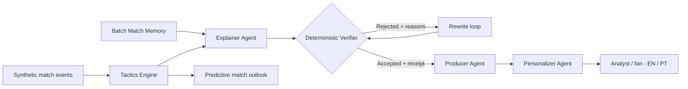

# FIEL — Football Intelligence Engine, Live

> **Every sentence on air comes with a receipt.**

[](https://www.python.org/)
[](https://ai.azure.com/)
[](https://learn.microsoft.com/agent-framework/)
[](LICENSE)
[](#quick-start)
[](docs/MCP.md)

FIEL turns a live stream of **synthetic football events** into clear, timely and verifiable match insights for broadcasters and fans. Instead of asking an AI model to improvise commentary, FIEL gives it computed facts, requires it to cite the underlying event IDs, and checks every claim before it can go on air.

**[Open the interactive judge experience →](https://willian-yudy-f.github.io/fiel-live/)**

Built for the **Microsoft × Premier League Inside the Game Hackathon**, FIEL addresses the challenge **“The Synthetic Match Insights Engine for Premier League Studio.”**

## The problem

Live football produces more data than a production team or viewer can interpret in real time. AI can turn that data into natural language, but three problems remain:

- **Signal overload:** raw passes, shots and recoveries do not explain what is changing in the match.
- **Trust:** a fluent AI-generated sentence can still contain a wrong number, cite the wrong time window or overstate correlation as causation.
- **One-size-fits-all output:** a studio analyst and a casual fan need different levels of detail, even when the underlying facts are the same.

In a live broadcast, a confident but unsupported statement is worse than no statement at all.

## Our solution

FIEL separates **facts** from **storytelling**.

1. A generator creates realistic matches between fictional teams, including known tactical patterns that can be used as ground truth.
2. A deterministic tactics engine calculates possession, pressing, shot quality and win probability directly from match events.
3. An Explainer powered by Microsoft Foundry selects a meaningful fact and writes a short broadcast claim.
4. A non-AI Verifier independently recomputes the metric and checks the cited evidence, time window and causal language.
5. If the claim fails, it is returned with a precise reason and rewritten. If it still fails, it never goes on air.
6. Accepted intelligence can then be produced and personalized for different audiences without changing the facts.

The result is a simple promise: **every published claim can show exactly where it came from.**

## How it works



The agent hand-offs are executed by **Microsoft Agent Framework 1.23**. Model-backed
roles call a `gpt-5-mini` deployment in **Microsoft Foundry**; the Verifier, Match
Memory, tactical metrics and evidence receipts remain deterministic Python.

The same deterministic engine is served three ways, from one code path: the
**FastAPI service on Azure App Service** (feeds the public judge experience),
the **MCP server** (lets external agents such as GitHub Copilot or Foundry
agents call `get_match_state`, `get_events`, `get_team_memory` and
`verify_claim` as tools) and the local **Streamlit Agent Desk**.

Each candidate insight is a structured object rather than unrestricted prose:

```json
{
  "claim": "Team B recovered the ball higher up the pitch between minutes 69 and 79.",
  "metric": "recovery_height",
  "value": 59.5,
  "team": "B",
  "window_start": 69,
  "window_end": 79,
  "event_ids": ["e0812", "e0839", "e0871", "e0904", "e0930"],
  "causal": false,
  "confidence": 0.91
}
```

The receipt is the metric, value, time window and supporting event IDs. The Verifier uses those fields to reproduce the calculation without relying on the language model.

## Five-stage insight pipeline

| Stage | What FIEL does | Current component |
| --- | --- | --- |
| **Ingest** | Creates and validates event-by-event synthetic match data | Synthetic Generator + Pydantic schemas |
| **Interpret** | Converts events into tactical signals | Tactics Engine |
| **Explain** | Finds a relevant story and attaches supporting evidence | Foundry Explainer + Verifier |
| **Render** | Selects and formats accepted insights for delivery | Producer |
| **Personalize** | Changes language and depth while preserving the verified facts | Personalizer with re-verification |

## What makes FIEL different

- **Evidence by design:** claims must cite real event IDs from the selected match window.
- **Independent verification:** facts are recalculated in Python; the AI does not grade its own work.
- **Visible failure recovery:** rejected claims receive specific feedback and enter a bounded rewrite loop.
- **Measurable synthetic ground truth:** the generator deliberately plants tactical stories, allowing us to measure whether the system discovers them.
- **Causality guardrails:** phrases such as “won the game” are blocked unless the claim is explicitly causal and has enough evidence.
- **Safe personalization:** analyst/fan modes and English/Portuguese may change wording, but not the verified numbers or evidence.
- **No third-party match data:** all teams, players and events are fictional and generated specifically for this project.

## Current capabilities

- Four fictional tactical team profiles: high press, low-block counter, possession and direct play
- Six reproducible synthetic matches with 800–1,200 events each
- Ten planted tactical stories with separate ground-truth files
- Verified metrics: possession, recovery height, shots, shots on target, goals and pass accuracy
- Tactical analytics: five-minute pressure index, transparent xG and Monte Carlo/Poisson win probability
- Match Memory baselines for possession, pass accuracy, recovery height and pressure, with historical receipts
- Microsoft Foundry integration through the OpenAI-compatible v1 endpoint
- Narrate → verify → rewrite loop with a maximum of two rewrites
- A staged demo in which an unsupported causal claim is rejected and corrected
- Microsoft Agent Framework graph: Explainer/Verifier → Producer → Personalizer
- Foundry-backed audience modes for analyst/fan in English and Portuguese, with re-verification and safe fallback
- Public judge experience on GitHub Pages that reads live numbers from the Azure-hosted API (minute-by-minute outlook, on-air package, clickable receipt listing the real events) and falls back to the stored Foundry run when the free tier is asleep
- FastAPI service on Azure App Service with nine endpoints, including `GET /matches/{id}/memory` and `POST /matches/{id}/verify` (run the verifier on any claim from Swagger, no model call)
- MCP server exposing seven deterministic tools to external agents ([docs/MCP.md](docs/MCP.md))
- Streamlit Agent Desk for local replay
- Reproducible 30-match evaluation: 49/49 planted signals detected, 49/49 unsafe causal claims rejected, and 49/49 safe corrections accepted
- 47 offline tests across generation, verification, tactical memory, API, MCP server and orchestration

## Demo: rejection before broadcast

The terminal demo intentionally proposes an exaggerated statement:

```text
"The substitution at 69' won the game for team B."
```

The Verifier rejects it because the causal language is not supported by enough evidence. The Explainer receives that reason and rewrites the statement as a measurable observation. Only the verified version is marked **ON AIR**.

This is the central FIEL interaction: the audience sees the useful insight, while the production team can inspect its receipt and the system's reasoning trail.

## Visual replay dashboard

FIEL includes an offline-first Streamlit dashboard for exploring the current MVP without making a model call. It provides:

- A match selector and minute-by-minute replay control
- Live score, xG, win probability and processed-event counters
- Win-probability and pressure timelines
- A pitch map of recent goals, shots, recoveries, substitutions and fouls
- A verified insight with its supporting event IDs
- A Verification Lab showing `REJECTED → REWRITTEN → ON AIR`
- A Foundry Agent Desk showing Match Memory, Agent Framework hand-offs, on-air rundown and historical receipts
- The planted synthetic stories used as evaluation ground truth

After installing the dependencies, launch it with:

```bash
streamlit run dashboard.py
```

The dashboard opens at `http://localhost:8501` by default. Azure credentials are not required for this visual replay.

## Quick start

### Requirements

- Python 3.12 or later
- A Microsoft Foundry project with a deployed model
- Foundry endpoint and API key for the optional model-powered demo

### Install

```bash
git clone https://github.com/Lmg15186/fiel.git
cd fiel

python3.12 -m venv .venv
source .venv/bin/activate  # Windows: .venv\Scripts\activate
pip install -r requirements.txt
```

### Run the offline tests

The tests do not call a model and do not require Azure credentials.

```bash
pytest -q
```

Expected result: `47 passed`.

### Generate synthetic matches

```bash
python -m fiel.generator --matches 6 --seed 2026 --out data
```

For every match, FIEL writes an event file and a separate `_truth.json` file containing the stories intentionally planted for evaluation.

### Configure Microsoft Foundry

```bash
cp .env.example .env
```

Add your own values to `.env`:

```dotenv
FOUNDRY_ENDPOINT=https://your-resource.openai.azure.com/openai/v1
FOUNDRY_API_KEY=your-key
FOUNDRY_DEPLOYMENT=gpt-5-mini
```

Never commit `.env` or expose an API key in logs, screenshots or issues.

### Run the verification demo

```bash
python run_demo.py data/m-003-T4-T3.json
```

The demo prints tactical context, candidate claims, acceptance or rejection reasons, and the final statement allowed on air. It also writes the attempt history to `data/last_run.json`.

### Run the reproducible evaluation

```bash
python evaluate.py --matches 30 --seed 2026
```

This offline benchmark measures planted-story signals, verifier rejection of
unsupported causal claims, safe correction acceptance and deterministic
processing latency. It does not claim to measure language-model quality. See
[docs/EVALUATION.md](docs/EVALUATION.md).

### Run all model-backed roles

```bash
python run_agents.py data/m-003-T4-T3.json --audience fan --language pt
```

This runs the Microsoft Agent Framework workflow: Explainer, deterministic
verification and rewrite, Producer, then Personalizer. The final output and every evidence receipt are saved to
`data/last_agents_run.json`.

### Run the API and the MCP server

```bash
uvicorn fiel.api:app --reload --port 8000   # Swagger UI at http://127.0.0.1:8000/docs
python -m fiel.mcp_server                   # MCP over stdio, for Copilot / Claude / Foundry agents
```

Try the trust boundary from Swagger: `POST /matches/m-003-T4-T3/verify` with the
receipt from `GET /matches/m-003-T4-T3/claims`, change `value`, and watch the
verifier return the exact mismatch. The MCP tools and client configuration are
described in [docs/MCP.md](docs/MCP.md).

For a more detailed setup guide, see [docs/SETUP.md](docs/SETUP.md). The event contract is documented in [docs/EVENT_SCHEMA.md](docs/EVENT_SCHEMA.md).

## Repository structure

```text
fiel/
├── .github/workflows/     # CI: full test suite on every push
├── dashboard.py           # Interactive offline replay and verification demo (Streamlit)
├── data/                  # Synthetic matches, planted-story truth, cached Foundry run, evaluation
├── deploy/                # Azure App Service deployment script (Cloud Shell)
├── docs/                  # Architecture, setup, event schema, MCP, evaluation, submission, video
├── fiel/
│   ├── claims.py          # Typed Event, Match, Claim and Verdict contracts
│   ├── generator.py       # Synthetic match and story generator
│   ├── tactics.py         # Pressure, xG and win-probability calculations
│   ├── memory.py          # Historical tactical baselines and receipts
│   ├── verifier.py        # Deterministic evidence, causality and baseline checks
│   ├── llm_json.py        # JSON-only Foundry model client
│   ├── explainer.py       # Foundry Explainer and bounded rewrite loop
│   ├── producer.py        # Ranks only approved claims for the rundown
│   ├── personalizer.py    # Analyst/fan, EN/PT wording with re-verification
│   ├── agent_workflow.py  # Microsoft Agent Framework executors and hand-offs
│   ├── api.py             # FastAPI service (deployed on Azure App Service)
│   └── mcp_server.py      # MCP server: the engine as tools for external agents
├── tests/                 # 47 offline tests (no model calls)
├── web/                   # React source of the public judge experience (GitHub Pages)
├── Dockerfile.api         # Container image for the API (alternative to App Service)
├── run_demo.py            # Verification and rewrite demonstration
├── evaluate.py            # Reproducible synthetic ground-truth benchmark
└── run_agents.py          # CLI entry point for the Agent Framework workflow
```

## Microsoft technology

| Technology | Role in FIEL |
| --- | --- |
| **Microsoft Foundry** | Hosts `gpt-5-mini` for Explainer, Producer and Personalizer structured outputs |
| **Azure OpenAI-compatible v1 API** | Provides structured JSON model responses through the standard Python client |
| **Microsoft Agent Framework 1.23** | Runs typed agent hand-offs and yields the complete broadcast package |
| **Model Context Protocol (MCP)** | `fiel/mcp_server.py` (official Python SDK) exposes match state, events, team memory, the cached broadcast and the verifier as tools for external agents. This is our own MCP server, not the Azure MCP Server product |
| **GitHub Actions** | Runs the complete automated test suite on every push |
| **GitHub Pages** | Hosts the credential-free public judge experience |
| **Azure App Service** | Hosts the public FastAPI service and OpenAPI documentation on an F1 Free plan |
| **GitHub** | Public source code, collaboration and project delivery |

The judge experience on GitHub Pages reads every number from the FastAPI
service on Azure App Service
([`fiel-api-c3839e.azurewebsites.net/docs`](https://fiel-api-c3839e.azurewebsites.net/docs))
and shows the stored output of a real Foundry run for the on-air package, so it
stays available to judges without secrets, quota or tenant access. If the free
tier is cold, the page falls back to the same stored package and labels it.

## Project status

FIEL is a complete hackathon MVP: the public replay, predictive analytics,
Foundry agents, deterministic verification, historical Match Memory, FastAPI
service on Azure, MCP server and quantitative evaluation are implemented. The
change history is in [docs/CHANGELOG.md](docs/CHANGELOG.md). See
[the architecture](docs/ARCHITECTURE.md), [Azure deployment](docs/AZURE_DEPLOY.md), [evaluation](docs/EVALUATION.md) and
[submission guide](docs/SUBMISSION.md). The team hand-off and final delivery
checklist are in [docs/HANDOFF_LUIZA.md](docs/HANDOFF_LUIZA.md).

## Team

- **Willian Yudy Futema** — synthetic data, tactics engine, API, Match Memory and public demo delivery
- **Luiza Miranda Gomes** — Foundry agents, verification, evaluation and replay experience

## Responsible use and limitations

FIEL is a hackathon prototype built with synthetic data. Its xG, pressure and win-probability calculations are transparent demonstration models, not production-grade sporting forecasts. The current evidence checks reduce unsupported output but do not replace human editorial oversight in a real broadcast workflow.

No real club names, crests, colours, players or proprietary match feeds are used in the repository.

## License

This project is available under the [MIT License](LICENSE).
