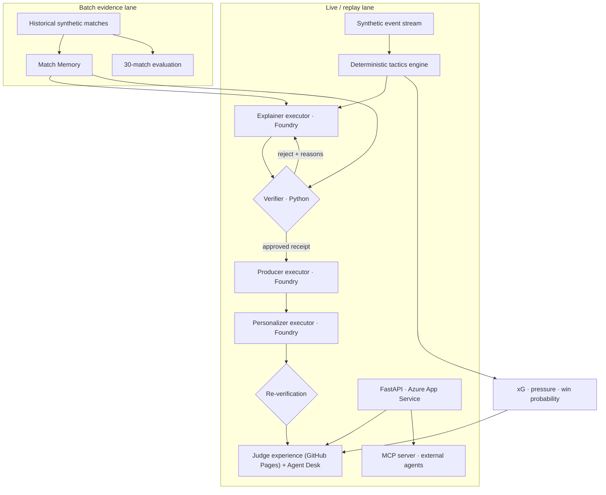

# FIEL architecture

FIEL is a hybrid live/batch system. Low-latency match intelligence runs from the
event stream; historical baselines and evaluation run in batch because neither
needs a distributed streaming broker for this synthetic hackathon workload.

## Runtime responsibilities

| Component | Responsibility | Failure behaviour |
| --- | --- | --- |
| Generator | Reproducible fictional matches plus separate planted truth | Fixed seed makes results repeatable |
| Tactics engine | Possession, pass accuracy, recovery height, pressure, xG and win probability | Transparent Python calculations |
| Match Memory | Usual team values from other matches, never the current match | Historical match IDs travel with the claim |
| Explainer/Verifier executor | Foundry writes one claim; Python checks value, window, IDs and causality | At most two rewrites, otherwise hold |
| Producer executor | Selects and ranks only accepted claims | Invalid/duplicate indices and repeated metrics are removed |
| Personalizer executor | Analyst/fan and EN/PT wording | Re-verifies receipt; falls back to approved original on drift |
| FastAPI on Azure App Service | Machine-readable endpoints for the judge experience: state, timeline, memory, events, broadcast and `POST /verify` | Public F1 Free plan; if it is asleep the UI falls back to the stored Foundry package and says so |
| MCP server | Exposes the same deterministic engine as tools for external agents (Copilot, Foundry agents, Claude) | Stdio transport, no model calls, same code paths as the API |
| Streamlit Agent Desk | Local replay for development and the video | Offline-first, no credentials |

## Trust boundary

The model may choose and phrase an insight. It cannot decide whether its own
claim is true. A claim reaches the on-air package only when Python can recompute
its metric from the cited window and event IDs. Historical comparisons also
require the exact baseline and source match IDs.

## Technology decisions

- **Agent Framework** is justified by typed, observable hand-offs between specialised roles.
- **Foundry** is used for constrained structured generation, ranking and language adaptation.
- **Azure App Service (F1 Free)** was chosen over Container Apps for the public API: zero cost for a low-traffic judge demo and a one-script deploy from Cloud Shell; the trade-off is cold starts, which the UI handles with a visible cached fallback.
- **MCP** is the integration surface for agents outside FIEL; Agent Framework is the orchestration inside FIEL. Both reuse the same deterministic functions, so there is one source of truth for every number.
- **No Kafka/Spark/Snowflake/dbt**: the data volume and business need do not justify them.
- **No trained ML model claim**: the transparent Monte Carlo/Poisson outlook is honest for six source matches; training can follow with a larger dataset.
